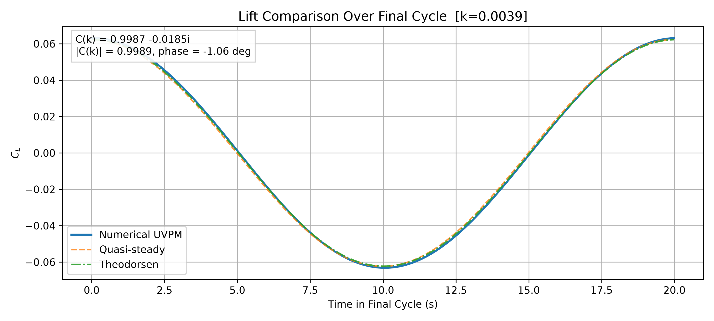
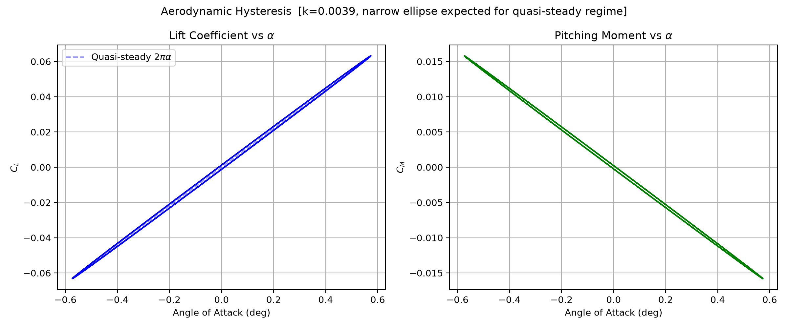
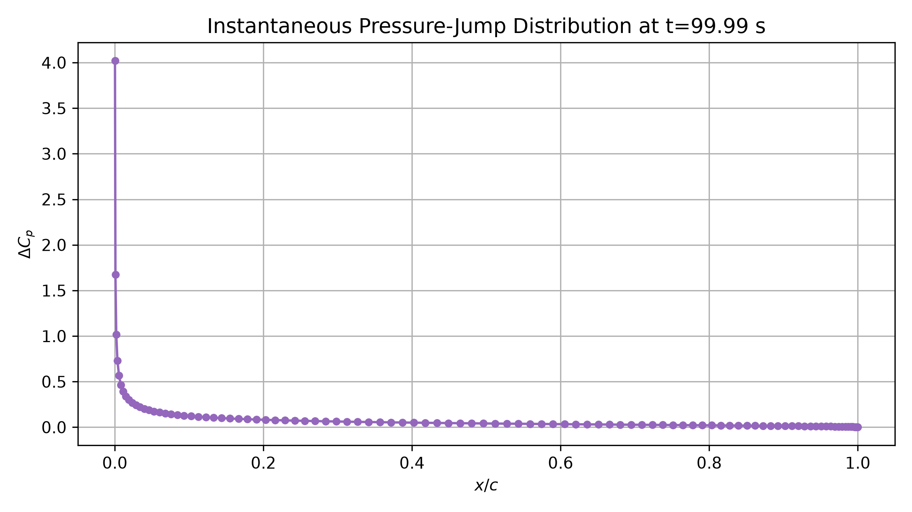
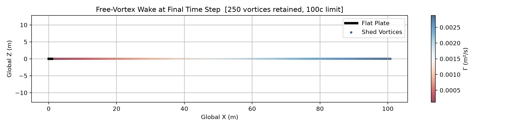
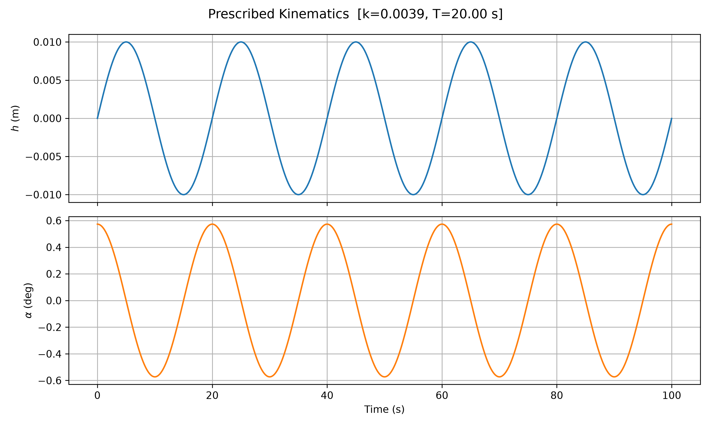
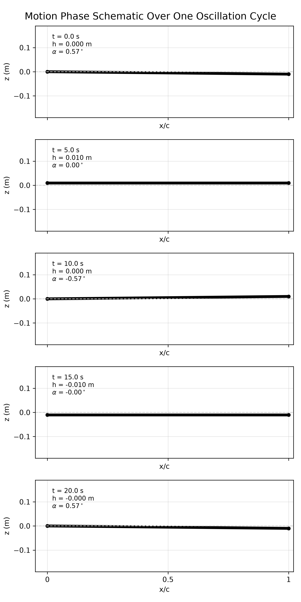
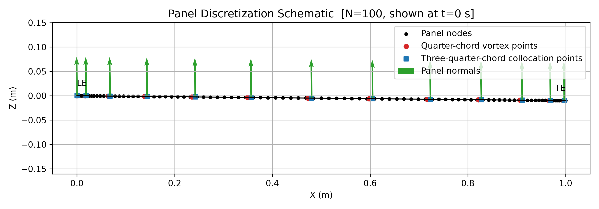
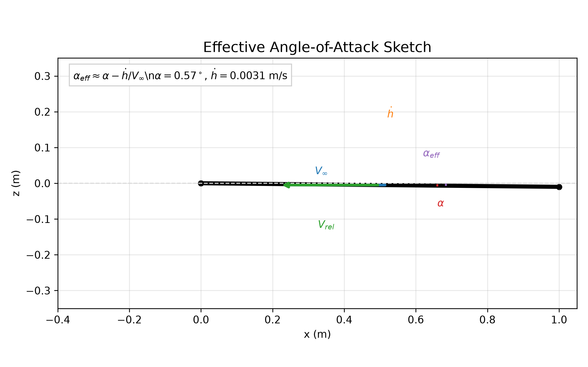
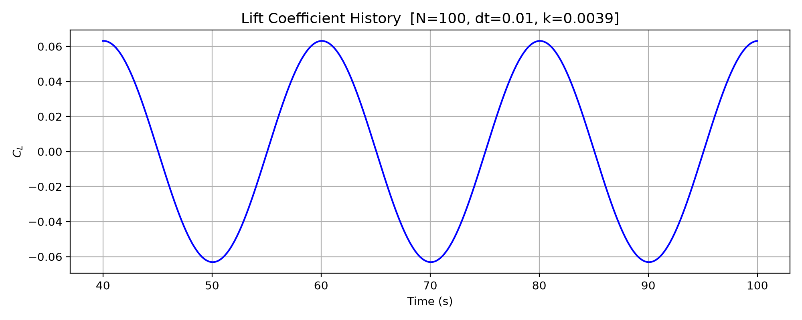
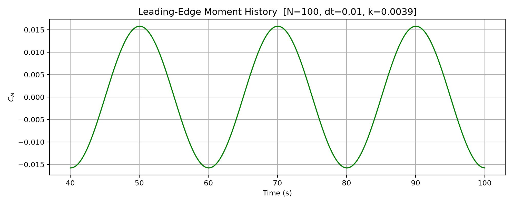

<div align="center">

# Unsteady Vortex Panel Method: Oscillating Flat Plate

*Lift, moment and wake of a flat plate in combined heave and pitch, computed with a lumped-vortex
unsteady panel method and checked against thin-airfoil theory and Theodorsen.*


[](LICENSE)

**Bishwaswarup Nayak** · Indian Institute of Science, Bengaluru · term project, AE 221 Aerodynamics

</div>

---

## Results

Plate of chord c = 1 m in U∞ = 40 m/s, heaving ±0.01 m and pitching ±0.01 rad (0.57°) about the leading
edge, pitch leading heave by 90°, ω = 0.1π rad/s, so the reduced frequency is k = ωc/2U∞ = 0.0039 (nearly
quasi-steady). Numbers from the `research` preset (100 panels, Δt = 0.01 s, 100 s, 250 wake vortices),
written by `main.py` to [`results/summary.json`](results/summary.json):

| | UVPM | reference |
|---|---|---|
| Steady flat plate, C_L / 2πα | 1.0001 | 1 (thin-airfoil theory) |
| Steady flat plate, C_M,LE / (−C_L/4) | 1.00 | 1 |
| Oscillating C_L amplitude | 0.0631 | 0.0623 (Theodorsen), **+1.4 %** |
| Phase of C_L relative to Theodorsen | −0.49° | 0° |
| C_M,LE amplitude | 0.0158 | ≈ C_L/4 |
| Peak pressure drag C_D | 6.3 × 10⁻⁴ | (no leading-edge suction modelled) |

The remaining 1.4 % comes from the explicit wake shedding (the new wake vortex lags the bound solution by
one step) and the truncated far wake; it is the same for every preset (1.4–1.6 %).

<p align="center"></p>

*Lift over the final cycle: UVPM, quasi-steady 2πα_eff and Theodorsen with C(k) = 0.9987 − 0.0185i.*

<p align="center"></p>

*Lift and leading-edge moment against angle of attack. At k = 0.004 the hysteresis loops are almost closed
lines on the quasi-steady slope.*

<table>
<tr>
<td width="50%"><br><sub>Pressure jump at the final step: the 1/√x leading-edge singularity and ΔC_p → 0 at the trailing edge (Kutta condition).</sub></td>
<td width="50%"><br><sub>Shed vortices over the last 100 chords, coloured by strength. At these small amplitudes the wake stays flat.</sub></td>
</tr>
</table>

<details>
<summary>More figures</summary>

| | |
|:---:|:---:|
|  |  |
| Prescribed heave and pitch | Plate position over one cycle |
|  |  |
| Panel layout: vortex at ¼, collocation at ¾ of each panel | Effective angle of attack from heave and pitch rate |
|  |  |
| Lift history after the start-up transient | Leading-edge moment history |

</details>

---

## Fix in this version

The first version used the wake vortex core (r_c = 0.02c to 0.05c) inside the bound-vortex influence
matrix too. Near the leading and trailing edges the cosine-spaced panels are far shorter than that core,
so the smoothed kernel under-predicted the panels' influence on each other and the solver compensated
with too much circulation: a steady plate gave **C_L = 1.12–1.26 × 2πα**, and the oscillating case was
13 % above Theodorsen (0.0706 against 0.0623). The bound vortices and collocation points never coincide,
so the bound matrix needs no core; with r_c = 0 there the steady plate gives 1.0001 × 2πα and the
oscillating case agrees with Theodorsen to 1.4 %. The core is still applied to wake vortices, which can
approach each other. `tests/test_uvpm.py::test_core_must_not_enter_bound_aic` guards against the bug.

---

## Method

Following Katz & Plotkin, *Low-Speed Aerodynamics*, ch. 13:

- **Discretisation.** N panels (cosine or uniform spacing), each with a lumped vortex at ¼ panel and a
  collocation point at ¾ panel, which enforces the Kutta condition implicitly.
- **Kinematics.** h(t) = h₀ sin ωt, α(t) = α₀ sin(ωt + φ), pitch about the leading edge.
- **Each time step.** Convect the free wake (forward Euler, bound + wake-induced velocity), solve the
  N × N no-penetration system for the bound circulation, shed a wake vortex at the trailing edge with
  Γ_new = −ΔΓ_bound (Kelvin), then truncate wake beyond `wake_chords` chords.
- **Loads.** Unsteady Bernoulli: Δp_j = ρ (U∞ Γ_j / Δx_j + ∂/∂t Σ_{k≤j} Γ_k), integrated for the normal
  force and the leading-edge moment; pressure drag is F_N sin α (leading-edge suction is not modelled).
- **Reference.** Theodorsen lift with R. T. Jones's approximation of C(k), including the
  non-circulatory terms, evaluated from the first harmonic of the prescribed motion.

---

## Run

```bash
git clone https://github.com/Bishwaswarup/uvpm-oscillating-plate.git
cd uvpm-oscillating-plate
pip install -r requirements.txt

python config.py      # preview the chosen preset and the run-time estimate
python main.py        # run; figures → figures/, numbers → results/   (~40 s for 'research')
pytest -q             # 7 validation tests, ~3 s
```

Choose the preset at the top of [`config.py`](config.py):

| preset | panels | Δt (s) | wake (chords) | run time | C_L amplitude vs Theodorsen |
|---|---|---|---|---|---|
| `fast` | 20 | 0.1 | 25 | < 1 s | +1.6 % |
| `balanced` | 50 | 0.0125 | 50 | ~4 s | +1.6 % |
| `accurate` | 80 | 0.0125 | 80 | ~10 s | +1.5 % |
| `research` | 100 | 0.01 | 100 | ~40 s | +1.4 % |

`PRESET = 'custom'` uses the `CUSTOM` dictionary, where the physics (speed, frequency, amplitudes) can be
changed too.

## Files

```
config.py           parameters, presets, validation and preview (was setup.py)
main.py             runs the simulation and writes every figure and result
simulate.py         time-marching loop (used by main.py and the tests)
kinematics.py       heave/pitch motion and plate geometry
vortex_math.py      Biot–Savart kernels and the bound-vortex influence matrix
solver.py           right-hand side and bound-circulation solve
wake_management.py  wake convection and shedding
forces.py           pressure jump, lift, drag, moment
post_processing.py  Theodorsen reference and plotting
tests/              steady-plate, moment, Kelvin, Theodorsen and AIC-core tests
figures/, results/  outputs of main.py
```

## Limitations

- Small-amplitude, attached, inviscid flow; no leading-edge suction, separation or dynamic stall.
- Explicit shedding (one-step lag) and wake truncation leave a ~1.4 % lift-amplitude offset at this k.
- Only the low reduced frequency of the assignment (k = 0.004) is validated here; higher k needs a
  longer retained wake and a finer time step.

## Reference

J. Katz and A. Plotkin, *Low-Speed Aerodynamics*, 2nd ed., Cambridge University Press, 2001.
T. Theodorsen, *General theory of aerodynamic instability and the mechanism of flutter*, NACA Report 496, 1935.

## License

MIT, see [LICENSE](LICENSE).
